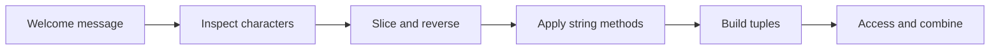

<h1>🐍 PYTHON QUEST 01</h1><h3>STRING & TUPLE ISLANDS</h3>

## Choose your learning path
<table><tr><td align="center"><h1>🔤</h1><b>STRING ISLAND</b> Index · Slice · Reverse Upper · Lower · Replace · Count</td><td align="center"><h1>📦</h1><b>TUPLE ISLAND</b> Create · Access · Concatenate Repeat · Select · Slice</td></tr></table>

## Mission route

## Launch the exercise

[Assignment PDF](Python_Assignment_1.pdf)

## How to complete
1. Open the notebook in Jupyter / JupyterLab.
2. Restart the kernel and run all cells.
3. Enter a name when prompted.
4. Compare your output with the saved example.

The saved output uses “Shanmukh” as sample input; the notebook prompt remains interactive.

**Skills earned:** string indexing, slicing, built-in methods and tuple operations.